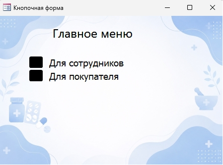
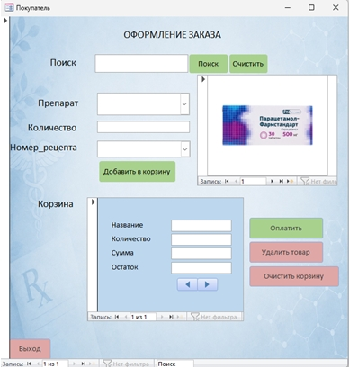
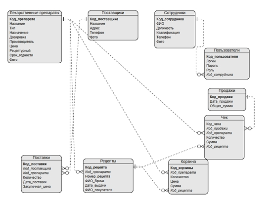
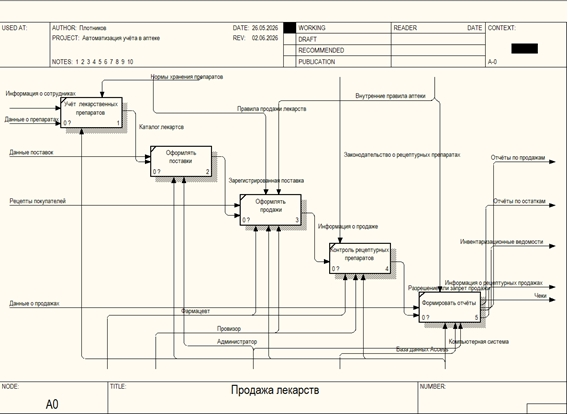
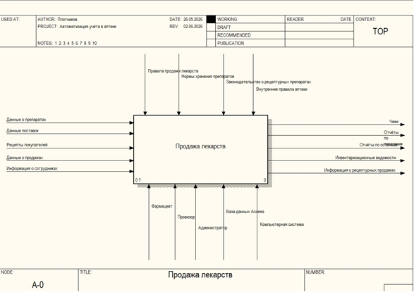
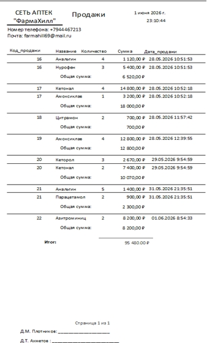

# АРМ для автоматизации учёта в аптеке

[🇬🇧 Read this README in English](README.md)

## О проекте

Учебный проект на базе Microsoft Access, предназначенный для автоматизации учёта лекарственных препаратов, поставок, продаж, процессов, связанных с рецептурным отпуском, и формирования отчётности.

Проект объединяет проектирование реляционной базы данных, работу с SQL-запросами, разработку пользовательского интерфейса, моделирование бизнес-процессов и создание отчётов.

**Статус проекта:** учебный прототип, не готовая к промышленной эксплуатации аптечная система.

## Используемые технологии

- Microsoft Access
- Access SQL и QBE
- VBA и макросы Access
- Проектирование реляционных баз данных
- Моделирование процессов IDEF0

## Реализованные возможности

- Справочники лекарственных препаратов и поставщиков
- Учёт поставок
- Формы для работы с сотрудниками и пользователями
- Форма авторизации и логика доступа, связанная с ролями
- Форма продажи с корзиной
- Автоматический расчёт итоговой суммы заказа
- SQL-запросы для анализа продаж
- Отчёты по продажам, поставкам и данным о рецептах
- Отдельные проверки в сценариях оформления продаж

## Скриншоты

### Интерфейс приложения

*Главное меню для перехода к сценариям сотрудников и покупателей.*

*Форма продажи с поиском препарата, количеством, номером рецепта, корзиной и элементами управления заказом.*

### Проектирование базы данных

*Связи между основными таблицами базы данных.*

### Моделирование бизнес-процессов

*Модель процесса работы аптеки в нотации IDEF0.*

*Контекстная диаграмма IDEF0.*

### SQL и отчётность

*SQL-запрос для анализа продаж рецептурных препаратов.*

*Пример результата выполнения запроса.*

*Отчёт по продажам с позициями и итоговыми суммами.*

## Структура базы данных

База данных включает девять основных таблиц:

- Лекарственные препараты
- Поставщики
- Поставки
- Сотрудники
- Пользователи
- Продажи
- Позиции чека
- Рецепты
- Корзина

Модель содержит связи между продажами и их позициями, препаратами и поставками, поставщиками и поставками, а также другими связанными записями.

## Пример SQL-запроса

В проекте используется запрос Access SQL, который объединяет продажи, позиции чека и каталог лекарственных препаратов для выборки продаж препаратов с установленным признаком рецептурности.

Запрос демонстрирует:

- Использование `INNER JOIN`
- Фильтрацию с помощью `WHERE`
- Сортировку с помощью `ORDER BY`
- Получение данных из нескольких связанных таблиц

См. файл [`sql/prescription_medicine_sales.sql`](sql/prescription_medicine_sales.sql).

Запрос отбирает препараты по признаку рецептурности. Сам по себе он не проверяет действительность рецепта и соответствие нормативным требованиям.

## Мой вклад

Самостоятельно выполнил:

- Анализ предметной области аптеки
- Создание диаграмм бизнес-процессов IDEF0
- Проектирование модели базы данных и связей
- Создание таблиц и связей в Microsoft Access
- Разработку пользовательских форм
- Создание SQL- и QBE-запросов
- Разработку отчётов с группировками и итогами
- Реализацию отдельных проверок с помощью запросов, макросов и VBA

## Известные ограничения

Проект является учебным прототипом. Перед возможным использованием в реальной организации потребовалась бы дополнительная разработка и проверка.

- **Контроль сроков годности:** в текущей модели срок хранится в справочнике препаратов. Более надёжная система должна учитывать срок годности и количество для каждой партии поставки.
- **Складской учёт:** количество хранится в отдельном поле. Необходимо проверять согласованность остатков с поставками, продажами, возвратами и корректировками.
- **Авторизация:** в текущей реализации пароли хранятся в таблице Access. Это не подходит для промышленной эксплуатации; потребуется безопасное хеширование паролей и более надёжная модель контроля доступа.
- **Проверка рецептов:** фильтрация рецептурных препаратов не подтверждает действительность рецепта.
- **Целостность операций:** необходимо тестировать продажи с несколькими препаратами, частичные ошибки сохранения и согласованность итоговых сумм.
- **Готовность к эксплуатации:** безопасность, резервное копирование, аудит действий, одновременная работа пользователей и соблюдение применимых нормативных требований не сертифицированы.

## Навыки, которые демонстрирует проект

Microsoft Access · SQL · Проектирование реляционных баз данных · QBE · VBA · Формы и отчёты · Анализ бизнес-процессов · IDEF0

---

Проект представлен как учебная работа для демонстрации моих текущих технических навыков. Он не позиционируется как коммерчески внедрённая или сертифицированная аптечная система.
